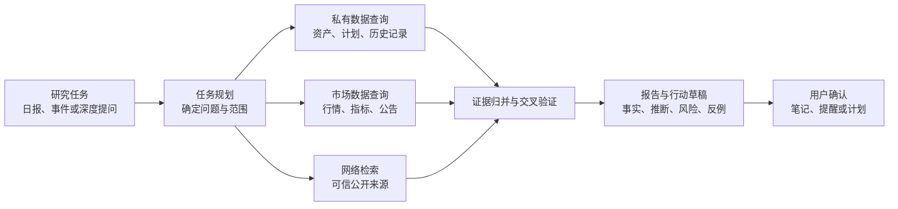

# IronMan 个人理财与资产增值增强方案

> **状态：规划文档（未实施）。** 本文写于 2026-07-31，描述的是目标能力，不是当前已上线的功能。除“提醒规则与触发记录、资金与持仓流水、AI 咨询、趋势计算、持仓诊断、AI 候选”等已有闭环外，文中提出的账户/组合、净资产快照、交易计划、投资目标与风险预算、复盘体系、AI 研究报告三层体系均**尚未实现**。已落地能力以 [frontend-menu.md](frontend-menu.md)（前端现状）与 `backend/src/app.ts`（后端路由）为准；两者与本规划的差异不要混读。
>
> 版本：2026-07-31
>
> 范围：全工程的产品功能、操作流程、界面与数据演进方案
> 定位：帮助个人建立可核对的资产底账、可执行的投资计划、可控制的风险边界和可复盘的决策记录；不承诺收益，也不替代用户的投资判断。

## 1. 产品判断

IronMan 已具备一个投资分析工作台的关键骨架：多用户隔离、标的与行情、资金与持仓流水、自选、K 线和技术指标、趋势计算、AI 咨询、提醒、笔记、数据源和备份管理。用户可以从标的检索进入自选或持仓，再通过趋势计算和提醒持续跟踪。

当前的重心仍是“看行情、做分析”。若目标升级为帮助个人资金长期增值，核心不应是增加更多指标或信号，而是将下面的闭环做完整：

这里的“增值”应被定义为：在目标收益、可承受风险、流动性需求和纪律约束之内，提升资金使用效率和决策质量。产品不应把单次涨跌或 AI 结论包装为确定收益。

## 2. 现状梳理

### 2.1 已有功能与价值

| 链路 | 已有能力 | 已经解决的问题 |
| --- | --- | --- |
| 账户与安全 | 注册登录、会话、用户隔离、审计、密码修改 | 私有资产和配置按用户隔离。 |
| 资产与资金 | 可用资金、资金调整流水、持仓、买入/卖出/计息、清仓记录 | 基本的现金与持仓变化可以追溯。 |
| 关注与行情 | 自选列表、目标价、实时/历史行情、K 线弹窗、数据源切换 | 用户可快速跟踪候选标的和价格变化。 |
| 分析 | 趋势策略、指标参数、异步运行、报告、风险提醒建议、报告 AI 解读缓存 | 指标信号和局部风险可以被解释、保存和复查。 |
| 提醒 | 价格、目标价、交易计划类规则，自动扫描、冷却、事件、系统建议 | 用户可以在站内管理规则和触发记录。 |
| 学习与复盘 | 韭菜笔记、AI 对话、指标说明、三方技术数据、资讯链接 | 研究过程有基本的沉淀入口。 |
| 系统治理 | 数据源与日历、规则扫描配置、AI 配置、导入导出、备份、缓存管理 | 本地部署、数据迁移和日常维护可控。 |

### 2.2 影响资产管理质量的主要缺口

| 优先级 | 缺口 | 影响 |
| --- | --- | --- |
| P0 | 没有资产总览、净资产时间序列和统一收益口径 | 用户难以回答“资产是否在增长、增长来自哪里、风险是否变大”。 |
| P0 | 资金只有单一可用余额，缺少账户、资金目标、外部现金流和用途分类 | 无法区分长期资金、交易资金、应急金，也无法理解真实投入与收益。 |
| P0 | 缺少投资目标、风险承受度、仓位和行业/资产类别约束 | 趋势建议难以落到“该不该买、买多少、是否超出风险预算”。 |
| P1 | 自选、趋势报告、持仓操作之间没有“交易计划”主线 | 研究结论无法形成可执行、可撤销、可复盘的决策。 |
| P1 | 提醒规则以单标的阈值为主，缺少组合风险、计划到期和数据异常提醒 | 用户会看到很多局部信号，却可能错过组合层面的风险。 |
| P1 | 收益分析缺少基准比较、现金流调整、回撤、归因和费用影响 | 容易把追加资金、市场 beta 或偶然收益误判为投资能力。 |
| P2 | 笔记、AI 对话、运行报告、交易记录之间的关联仍弱 | 复盘时难以还原“当时为什么这么做”。 |
| P2 | 导航没有把“今天最需要处理什么”作为首页 | 高频用户需要在 30 秒内了解资金、风险、待办和机会。 |

## 3. 目标产品结构

### 3.1 一级信息架构

现有导航可保留“自选、持仓、分析、提醒、笔记、设置”的基础，但建议以个人理财任务而不是数据来源组织：

| 一级入口 | 核心页面 | 用户要完成的事情 |
| --- | --- | --- |
| 总览 | 资产驾驶舱 | 判断资金状态、风险、待办和近期变化。 |
| 资产 | 账户与资金、持仓、自选 | 记录资产事实，维护可交易资金与观察池。 |
| 计划 | 投资目标、资产配置、交易计划 | 明确用途、期限、仓位边界与下一步动作。 |
| 分析 | K 线、趋势策略、技术数据、AI 咨询 | 为计划提供证据，而不是独立输出结论。 |
| 提醒 | 待处理提醒、规则、系统建议 | 及时处理已触发的风险和计划偏离。 |
| 复盘 | 交易复盘、组合复盘、笔记 | 评估过程与结果，修正规则和计划。 |
| 设置 | 数据、AI、规则、个人与安全 | 管理偏好、数据质量和隐私。 |

“大盘云图、技术数据、资讯链接”应归入“分析”的二级入口，不占据用户每日资产操作的注意力。

### 3.2 高频操作闭环

#### 每日：三分钟资产检查

1. 进入“总览”，先看净资产、当日盈亏、可用资金、组合风险和未处理提醒。
2. 只打开异常项：超仓、跌破计划价、临近止损/止盈、数据过期、交易计划到期。
3. 从异常项直达持仓、交易计划或提醒处理；处理结果自动形成时间线。
4. 没有异常时，不要求用户浏览大量指标或榜单。

#### 研究到交易：一条可回溯的决策链

1. 在自选或趋势报告中确认标的与分析证据。
2. 创建交易计划：方向、触发条件、计划区间、最大资金、止损/止盈或失效条件、有效期、理由。
3. 计划通过仓位和资金检查后，才进入“记录买入/卖出”。
4. 成交记录自动关联计划、当时快照、AI/趋势报告版本和备注。
5. 计划结束后提示复盘：计划是否执行、收益和最大回撤、偏离原因、下次规则是否调整。

#### 每周或每月：组合复盘

1. 查看净入金、净资产、区间收益、最大回撤、基准差、现金占比和目标偏离。
2. 查看收益归因：大类资产、标的、行业/主题、择时、费用。
3. 对偏离目标的账户/组合提出“补充现金、降低仓位、暂停新增、再平衡”建议。
4. 将结论写入组合复盘，不以聊天记录代替正式决策记录。

## 4. 功能增强方案

### 4.1 资产底账与绩效口径（P0）

这是后续风险控制、建议和复盘可信度的前提。

#### 账户、组合与资金用途

新增“账户”与“组合”两个层级：

- 账户：证券账户、基金账户、现金账户、模拟账户；记录名称、币种、是否计入总资产、初始余额和启用状态。
- 组合：例如“长期增值”“稳健现金管理”“高风险试验”；可包含多个账户，并设置独立目标和风险边界。
- 资金流水：区分入金、出金、买入、卖出、分红/利息、手续费、税费、转账和调整；调整必须填写原因。
- 现金用途：应急金、近期支出、长期投资、备用金。被标记为应急金的资金不能被默认计入可交易额度。

单账户模式可作为默认快速开始路径，旧的 `cash_accounts` 和 `cash_ledger` 数据应无损迁移到“默认账户”。

#### 净资产快照与收益

每天收盘后或用户首次打开时生成资产快照，至少记录：总资产、现金、持仓市值、成本、净入金、未实现盈亏、已实现盈亏、估值时间和数据质量状态。

收益指标分层展示：

| 指标 | 用途 | 说明 |
| --- | --- | --- |
| 净资产与净入金 | 回答资产规模变化 | 外部入金/出金不应被当作投资收益。 |
| 已实现/未实现盈亏 | 回答收益是否已落袋 | 与持仓和交易流水可相互校验。 |
| 时间加权收益率 | 衡量投资过程 | 尽量剔除资金进出对收益率的扭曲。 |
| 资金加权收益率（XIRR） | 衡量个人资金体验 | 反映实际入金时点带来的结果。 |
| 最大回撤与波动 | 衡量风险 | 不能只展示正收益。 |
| 基准超额 | 衡量是否优于被动持有 | 每个组合可选择沪深300、宽基 ETF 或自定义基准。 |

初期可先提供净资产、净入金、区间收益、最大回撤和简单基准；XIRR 与归因在有足够现金流数据后加入。

### 4.2 目标、风险与资产配置（P0）

#### 投资目标

每个组合支持创建目标：名称、目标金额、期限、优先级、预期年化范围、最大可接受回撤、流动性要求和备注。系统据此计算：

- 当前完成度和距离目标的缺口；
- 达成目标所需的月度净投入或合理收益区间；
- 当风险承受范围与目标期限不一致时的提示；
- 不把“预期收益”解释为承诺收益。

#### 风险预算与配置目标

用户为组合配置简单、可理解的约束，而非一开始要求复杂的量化模型：

- 现金下限；
- 单标的最大仓位；
- 单主题/行业最大仓位；
- 高波动资产总上限；
- 单笔计划最大金额；
- 止损后冷静期；
- 最大回撤预警线。

资产分类先采用用户可维护的分类和标签，例如宽基 ETF、行业 ETF、个股、固收/货币、现金。行业映射和更细的风格因子可在数据质量稳定后补充。

### 4.3 自选到交易计划（P1）

自选列表不应只是“价格列表”，建议增加：

- 自选分组：核心持仓候选、观察、待买、待卖、已放弃；
- 标签和优先级：研究中、等待触发、风险观察、复盘；
- 一行计划摘要：计划方向、目标区间、失效条件、有效期、计划状态；
- 快捷入口：查看 K 线、创建交易计划、创建提醒、查看关联笔记与报告；
- 支持归档而非直接删除，保留放弃原因。

交易计划应成为一等资源，而不是提醒规则的附属字段：

| 字段 | 说明 |
| --- | --- |
| 标的与组合 | 计划属于哪个组合、针对哪个标的。 |
| 方向与状态 | 买入、减仓、卖出、观察；草稿、等待触发、已执行、已失效、已取消。 |
| 价格与资金 | 触发区间、计划金额/数量、最大允许仓位、止损/止盈或撤销条件。 |
| 时效与理由 | 创建日、有效期、研究理由、关联趋势运行报告、笔记和 AI 解读。 |
| 执行检查 | 可用资金、现有仓位、目标配置、近期冷静期、风险规则是否通过。 |

持仓页面的“增加操作”保留快速路径；当操作会违反约束时弹出说明和二次确认，而不是静默拦截。

### 4.4 组合级监控与提醒（P1）

现有价格、目标价和交易计划类提醒可保留，并扩展为四层：

| 层级 | 规则示例 | 用户价值 |
| --- | --- | --- |
| 数据质量 | 行情超过设定时长未更新、主数据源持续失败 | 避免基于旧价做决策。 |
| 单标的 | 价格穿越、波动异常、趋势转弱、计划到期 | 及时处理明确标的事件。 |
| 持仓/计划 | 仓位超限、止损触发、计划金额超现金、分批计划逾期 | 让计划真正约束操作。 |
| 组合 | 现金低于下限、单主题集中度超限、净值回撤超过阈值、目标偏离 | 防止局部正确而整体失控。 |

提醒中心建议以“待处理队列”为默认页，而不是先展示所有规则：

- 按风险、时效、组合分组；
- 每条提醒显示“为何触发、影响金额/仓位、建议动作、可选操作”；
- 支持确认、延后、忽略、转为交易计划、标记已处理；
- 显示关联规则、最近行情、冷却时间和历史处理结果；
- 自动扫描只在站内执行与展示，本期不引入外部推送渠道、外部通知系统或其他执行型对接。

### 4.5 AI 投研代理：自主研究、深度报告与决策辅助（P1）

AI 应成为“解释、归纳、检索、检查与复盘助手”，以持续提高信息处理和投资纪律的质量；它不是直接下达买卖指令的黑箱，也不代替用户承担投资决策。

这里的“自主”指 AI 可以在用户许可的范围、频率和预算内自行规划检索、调用数据工具、交叉验证和生成站内报告；不代表其可以自动交易、向外部账户发出指令，或绕过网站权限、付费墙和数据使用规则。

#### 统一研究数据层

AI 不应只依赖对话上下文。它通过受控工具读取数据，每一次读取都携带来源、时间和范围：

| 数据层 | 可检索内容 | 使用原则 |
| --- | --- | --- |
| 用户私有事实 | 账户、资金流水、持仓、自选、交易计划、提醒、笔记、趋势运行和既有报告 | 仅在当前用户的隔离范围内检索；优先作为“我有什么、我做过什么”的事实依据。 |
| 市场与基础数据 | 行情、K 线、成交量、技术指标、交易日历、公告、财务与基础资料 | 统一经现有数据源适配层读取，保留数据源、市场时间和缺失状态。 |
| 公开网络信息 | 监管披露、交易所/公司公告、可信财经新闻、指数和宏观公开资料 | 通过可配置的搜索与读取工具按需检索；保存原始链接、抓取时间、摘要和内容指纹。 |
| 用户提供资料 | 用户导入或明确授权的文档、研报、网页链接和笔记附件 | 标识为用户材料，不自动视作外部事实；支持与公开来源交叉验证。 |

“所有信息”应落实为上述信息域的尽量充分检索，而不是无边界网页抓取。网络检索默认使用可管理的来源目录、访问频率和内容长度上限；对来源不明、发布时间不明、相互矛盾或不可访问的信息，报告必须降级为“待验证信息”。

#### 来源获取与优先级

数据和信息通过后端的“来源适配层”统一取得、清洗和缓存，AI 只调用语义化工具，例如“读取持仓快照”“查询标的近 30 日行情”“检索某公司最新披露”“查询宏观发布日历”，不直接拼接网址或操作网页。

| 信息类型 | 首选获取方式 | 备用方式 | 报告中的使用规则 |
| --- | --- | --- | --- |
| 价格、K 线、成交与技术指标 | 复用现有 `MarketDataProvider`，由 AkShare、本地 AkShare 服务、腾讯、东方财富等已接入来源按用户的主/备配置获取 | 已验证的本地行情缓存，并显示估值时点 | 必须标明市场时点、来源和缺失状态；过期行情不能作为“当日异动”的依据。 |
| 公司公告、定期报告与交易所事件 | 交易所披露页面和巨潮资讯等法定/官方披露渠道；先按证券代码、公告类型和日期精确查询 | 公司投资者关系页面，或用户提供的原始公告链接 | 一手公告优先级最高；保存公告日期、原始链接和内容摘要，报告引用时跳回原页。 |
| 宏观、货币与外汇数据 | 国家统计局的数据发布库和发布日历，以及外汇管理局等主管部门的统计数据/公开发布 | 主管部门正式新闻稿与数据解读 | 将指标值、统计期、发布时间和修订状态分开保存；“预期”与“已发布值”不能混写。 |
| 热点新闻与财经解读 | 通过配置的、可合法访问的主流财经信息源的 API、RSS 或检索接口拉取元数据和摘要 | 受频率、域名与正文长度限制的公开网页读取；用户手动添加链接 | 新闻用于发现事件与交叉验证，不高于一手披露；同一事件按主题聚合，保留来源差异。 |
| 用户研究资料 | 用户上传/粘贴/收藏的链接和笔记，写入用户私有资料库 | 无 | 作为用户研究证据单独标注，AI 可与公开资料比对但不能自动当作事实。 |

现有行情服务已经具备主源、备用源和本地回退模式，应在其基础上新增公告、宏观、新闻与资料四类适配器，而非为每种报告重新接入数据。行情适配器的现有实现可见 [market-service.ts](/Users/jie/Studio/Code/github/IronMan/backend/src/services/market-service.ts)。

信息生命周期统一为：`适配器拉取 -> 字段归一/去重 -> 缓存与来源快照 -> 主题与标的关联 -> AI 检索 -> 带引用报告`。缓存项至少保存来源、原始链接、发布时间、拉取时间、适用标的/主题、内容指纹、解析状态和过期时间；只有摘要、事实结构和必要的短引用进入报告，原始内容按来源许可处理。

“AI 研究”设置页新增“来源目录”配置：按行情、公告、宏观、新闻和用户资料分别展示已启用来源、覆盖范围、最近成功时间、失败原因、刷新频率与日预算。用户可以启停新闻来源、限制研究的市场/标的范围，并查看每次报告实际使用了哪些来源；数据源凭据只保存在服务端配置中，不写入浏览器或报告正文。

#### 三种工作方式

| 工作方式 | 触发时机 | 交付内容 |
| --- | --- | --- |
| 自主日常扫描 | 每个交易日收盘后、用户首次打开总览时，或由规则扫描发现异常时 | 日报：资产变化、持仓/自选异动、未处理风险、计划到期、重要公告/新闻、需要用户确认的事项。 |
| 事件驱动研究 | 价格大幅波动、趋势转折、公告发布、风险规则触发、组合偏离时 | 事件快报：发生了什么、与用户持仓/计划的关系、可确认事实、尚待验证项和观察动作。 |
| 用户发起深度研究 | 用户在标的、持仓、趋势报告、交易计划或 AI 研究入口主动发起 | 深度报告：分阶段检索本地数据、市场数据和网络来源，比较正反证据、风险情景和计划匹配度。 |

自主扫描只生成站内洞察、草稿和待处理提醒，不自行改变持仓、资金、交易计划或风险配置。用户可以对组合、标的、主题设置研究范围、扫描时段、最大运行次数和每日 AI/网络检索预算。

#### 高价值 AI 功能

1. **每日资产与风险简报**：把三类报告的关键结论、净资产、净入金、集中度、提醒和到期计划汇总为不超过一屏的行动清单；没有异常时明确告诉用户“无需操作”。
2. **单标的深度研究**：从行情结构、技术指标、公告/财务、新闻事件、用户持仓和已有研究出发，主动搜索相互支持与相互矛盾的证据，形成多空情景、关键价格/事件和失效条件。
3. **持仓与组合诊断**：识别集中度、现金下限、回撤、计划偏离和重复风险；解释“这条风险对总资产和目标的实际影响”，而不是只报一个指标信号。
4. **交易计划审阅**：在用户创建或修改计划时，检查资金、仓位、价格合理性、止损/失效条件、有效期、冷静期和与长期目标的冲突；返回可编辑草稿，不代替确认。
5. **事件解释与跟踪**：对提醒或异动自动聚合可能的公告、新闻和市场变化，标记事实、推断和未证实传闻；新证据出现时更新同一研究主题，而不是制造多条互相孤立的消息。
6. **周/月复盘与策略学习**：对计划、成交、收益、回撤、AI 建议和实际结果进行回顾，区分市场环境与执行纪律的影响，并统计提醒/策略的有效性。

#### 三层 AI 报告体系

AI 研究工作台的默认视图应提供相互独立、但可互相跳转的三类报告。它们共享来源与版本机制，不能把资讯堆成没有资产关联的内容流。

| 报告 | 研究对象与频率 | 内容与操作 |
| --- | --- | --- |
| **持仓诊断报告** | 当前所有持仓标的；每日收盘后生成，并在重大事件、趋势变化或规则触发后局部刷新 | 按标的逐行给出当前价格/成本、收益与仓位、趋势与关键证据、公告/新闻影响、与交易计划的偏离、主要风险、反例和“继续持有、观察、减仓评估、补充研究”等可选动作。按对总资产影响和紧迫度排序；点击标的可进入详细报告、K 线、计划或提醒草稿。 |
| **大盘研判报告** | 主要指数、市场宽度、成交/流动性、风险偏好、用户关注的行业/主题和宏观日历；每个交易日生成 | 说明市场所处状态、上涨/下跌驱动、领涨/承压主题、重要宏观/政策/财报事件与未来观察窗口；同时显示用户组合对这些主题的暴露，使大盘结论能回答“它与我的资产有什么关系”。 |
| **市场情报报告** | 热点新闻、监管/交易所/公司披露、主流财经报道、宏观数据与日历；持续采集、按固定时段归并 | 将重复新闻聚成主题，标记来源、发布时间、可信度和影响范围；区分已证实事实、市场解读与未证实传闻，并把主题映射到受影响的持仓、自选、行业和交易计划。用户可关注、忽略、追踪主题或发起深度研究。 |

持仓诊断中的“可选动作”是对风险、证据和计划匹配度的结构化提示，不能表现为无条件的买卖指令。若用户要记录买入、卖出或调整仓位，仍须进入交易计划或持仓操作并完成资金、仓位与确认检查。

#### 深度研究流程

研究任务应先生成计划，再按计划调用工具，并记录每一步调用。对于时间敏感问题，优先获取当日市场与公告数据；对于长期判断，优先比较多个周期和相互独立来源。工具失败或来源不足时，应交付可用的部分结论，并明确没有取得哪些证据，不能用模型补全假事实。

#### 报告标准与用户操作

每份 AI 日报、事件快报和深度报告均采用统一结构：

- 研究问题、覆盖范围和生成时间；
- 结论摘要与影响范围，包括涉及的账户、组合、持仓或计划；
- 可核验事实和对应引用；
- AI 推断、假设和证据强弱；
- 反例、主要风险、数据缺口和结论失效条件；
- 可选的下一步动作，例如继续观察、补充资料、创建提醒、调整交易计划草稿或进入复盘；
- 检索与模型元数据，包括数据时点、来源列表、模型版本、缓存状态和运行成本。

界面上新增“AI 研究”工作台，作为分析模块的二级入口：

- 页面顶部以“持仓诊断 / 大盘研判 / 市场情报”三个标签组织报告；每个标签保留最近生成时间、覆盖范围、数据新鲜度和刷新状态；
- 首页总览只展示三类报告的少量高优先级洞察和最新日报入口，避免 AI 内容淹没资产事实；
- 标的、持仓、趋势报告和交易计划提供图标入口，可直接发起相应上下文的深度研究；
- 研究中心支持按组合、标的、主题、日期、报告类型和证据状态筛选；
- 报告内可展开查看引用、原始链接和工具调用摘要，支持刷新研究、固定版本、归档、转笔记或创建计划草稿；
- “刷新”会创建新版本，旧版本仍可比对，不能静默覆盖已被用户引用的结论。

#### 可信、安全与成本边界

- AI 对网络信息只读访问，遵守站点访问与内容使用规则，不规避登录、验证码、付费墙或版权限制；
- 用户私有数据不得作为网络检索关键词或发送给非必要的第三方服务；对外发送前最小化、脱敏并记录用途；
- 把事实、来源摘要和模型推断在界面上视觉区分；不能引用的结论不进入“事实”区域；
- 对重大结论优先要求至少一个一手来源或两个独立可信来源；单一媒体、社交内容或无日期内容只可作为线索；
- 配置单次任务时间、检索次数、文本量、并发数和日预算，超限后停在可恢复状态并说明原因；
- 网络、行情或模型不可用时，使用已缓存且明确标记时效的数据，或者仅提示“无法完成研究”；
- 禁止自动创建交易、修改金额、删除规则或更改资产配置。AI 只能生成草稿，由用户在统一确认界面明确写入。

现有趋势报告 AI 解读缓存应继续保留，并扩展为报告版本、来源时间、模型版本、引用列表和“基于哪次趋势运行”的可见信息。AI 对话和研究报告中的结论可以一键转为笔记、提醒或交易计划草稿，但必须由用户确认写入。

### 4.6 复盘与学习（P2）

“韭菜笔记”保持为自由笔记，不承载提醒；另新增结构化复盘：

- 交易复盘：计划、执行、结果、最大浮亏、提前/延后/未执行原因、下次改进；
- 组合复盘：区间收益、回撤、配置偏离、基准比较、主要贡献与拖累；
- 决策时间线：把趋势运行、AI 解读、提醒、计划变更、成交和笔记按时间串联；
- 规则复盘：提醒命中率、误报率、处理时长、规则是否需要收紧或停用；
- 周/月复盘模板：AI 可以生成草稿，用户编辑后保存为正式记录。

## 5. 界面与操作优化

### 5.1 新增“资产驾驶舱”首页

在左侧主导航新增独立的“总览”入口，与“资产 > 持仓信息”并列。总览是面向每日判断的资产驾驶舱；现有持仓列表仍保留原有入口、表格密度、详情跳转和交易操作，不以驾驶舱页面替换它。总览可作为首次进入系统的默认页，但用户从“持仓信息”进入时应继续直接看到原有列表。

总览应优先回答四个问题：

1. 我的净资产、净入金与本期收益如何？
2. 现金、持仓和目标配置是否健康？
3. 今天有哪些必须处理的风险或计划？
4. 哪些持仓/自选值得进一步研究，而不是立刻交易？

建议页面按从“总体”到“行动”的顺序排列：

- 顶部：净资产、可交易资金、区间收益、最大回撤、数据更新时间；
- 中部左侧：资产配置与目标偏离；中部右侧：待处理提醒和即将到期计划；
- 下部：持仓贡献/拖累、自选异动、近期操作与复盘待办；
- 所有卡片提供一条明确跳转，不在首页堆叠编辑表单。

### 5.2 资产页面

| 页面 | 保留的强项 | 优化方向 |
| --- | --- | --- |
| 持仓信息 | 表格密度、交易流水、详情跳转、提醒快捷入口 | 加入组合筛选、仓位上限占用、计划状态、成本/收益口径说明、数据时间；把“增加操作”改为优先选择计划后执行。 |
| 持仓详情 | 持仓交易和图表基础 | 增加持有周期收益、最大回撤、分批交易效果、计划/提醒/笔记时间线、基准对比。 |
| 自选列表 | 紧凑行情、目标价、提醒与 K 线入口 | 增加分组、计划状态、优先级、研究完成度；默认排序突出待行动与风险项。 |
| 资金 | 已有现金账本能力 | 拆成账户余额、资金流水和预算/用途，明确“可交易资金”与“总现金”的差异。 |

### 5.3 分析页面

趋势计算的策略、运行记录、报告和 AI 缓存已经形成基础闭环。进一步优化：

- 策略页显示“适用场景、最近运行、触发过的提醒、历史有效性”，而不仅是参数；
- 报告列表增加计划关联状态和操作入口，例如“加入计划”“更新计划证据”；
- 分析结论优先显示证据与不确定性，风险颜色和趋势颜色不能被视为交易指令；
- 面向多标的的报告提供组合汇总，显示集中风险而不只逐行信号；
- AI 解读已经支持缓存，应增加来源、生成时间和“查看关联报告”入口。

### 5.4 减少操作摩擦

- 复用现有的标的检索、K 线弹窗、提醒图标和确认对话框，避免同一标的在不同页面有不同选择方式；
- 在创建持仓、目标价、计划、提醒时预填当前价格、已有仓位和可用资金；
- 表格操作继续以图标与 hint 为主，正文保留给价格、风险和计划信息；
- 任何删除、清仓、覆盖计划或违规交易都使用统一确认对话框；
- 移动端优先保证“查看总览、处理提醒、记录一笔操作、查看图表”四个流程，不强求完整表格编辑体验。

## 6. 数据与服务演进

### 6.1 推荐新增领域模型

| 模型 | 核心字段 | 与现有数据关系 |
| --- | --- | --- |
| `investment_accounts` | 用户、名称、类型、币种、是否计入净资产、可交易标记 | 承接现有现金账户和持仓归属。 |
| `portfolios` | 用户、名称、目标、风险等级、基准、状态 | 聚合多个账户和投资目标。 |
| `portfolio_allocations` | 组合、资产分类/标签、目标比例、上下限 | 用于配置偏离和再平衡。 |
| `cash_flows` | 账户、类型、金额、日期、用途、备注 | 将入金/出金与交易账本分离。 |
| `asset_snapshots` | 账户/组合、日期、净资产、现金、市场值、数据状态 | 支持收益、回撤和历史图。 |
| `investment_goals` | 组合、目标金额、期限、回撤、流动性、优先级 | 让建议有明确约束。 |
| `trade_plans` | 标的、组合、方向、金额/数量、触发、止损、有效期、状态 | 连接研究、提醒与成交。 |
| `decision_records` | 计划/交易、依据快照、报告、AI 解读、用户理由 | 建立可追溯决策链。 |
| `review_records` | 周期、组合、指标快照、结论、改进项 | 存储正式复盘。 |
| `research_tasks` | 用户、类型、范围、触发来源、优先级、状态、预算、调度时间 | 统一承接日报、事件扫描和用户发起的深度研究任务。 |
| `research_reports` | 任务、版本、结论、事实/推断结构、数据时点、模型、状态 | 保存可回看的 AI 日报、事件快报和深度报告。 |
| `research_sources` | 报告、来源类型、链接/内部对象、发布时间、抓取时间、摘要、内容指纹、可信度 | 将每项报告结论与私有数据、行情或公开来源对应起来。 |
| `research_tool_runs` | 任务、工具、输入摘要、结果摘要、耗时、错误、消耗 | 记录检索规划与执行过程，用于审计、重试、成本控制和问题排查。 |
| `research_preferences` | 用户/组合、研究范围、来源目录、扫描时段、预算、启用状态 | 保存用户对自主研究和网络检索的授权与偏好。 |

所有私有模型继续携带 `user_id` 并使用外键级联清理；行情与标的可共享。涉及余额、持仓和成交的写入必须维持单事务与审计日志。

### 6.2 计算与数据质量

- 资产快照与收益计算必须记录行情源、时间戳和缺失标的数量；
- 数据源失效时，界面显示“估值可能过期”，不能用静默旧价伪装实时价；
- 避免以实时价写死历史收益；历史快照一经结算应可追溯；
- 长耗时的快照、再平衡检查和趋势任务沿用现有调度/日志模式，支持幂等、失败记录和手工重试；
- 对规则、收益和 AI 计算提供可解释输入快照，便于排查。
- 网络检索适配层统一处理来源目录、请求超时、重试、频率限制、正文提取、版权/访问限制和内容去重；AI 代理只调用适配层，不直接访问任意 URL；
- 同一研究主题的行情、公告与网页结果应按时间线归并，引用原文时遵守来源许可并限制摘录长度；
- AI 任务需要持久化状态机，例如等待、规划、检索、生成、部分完成、失败、取消；用户可查看进度、恢复失败任务或停止尚未完成的任务；
- 以用户、组合和任务为边界施加工具权限及预算，禁止跨用户检索，禁止用一个用户的数据推断另一个用户的偏好或建议；
- 对市场数据、网络资料和 AI 结论分别保存时效标记，组合报告显示最旧关键证据的时间，避免“刚生成的旧结论”被误认为新研究。

## 7. 三阶段实施路线

### 阶段一：建立可信资产底账

目标：用户每天可以可靠地回答“我有多少钱、可动用多少、过去一段时间真实赚亏多少”。

1. 新建资产驾驶舱和默认账户迁移；
2. 账户、外部现金流、资金用途和净资产快照；
3. 净资产、净入金、区间收益、最大回撤、估值时间；
4. 持仓/资金页面接入账户筛选与数据新鲜度；
5. 为组合建立基础基准和资产分类。
6. 建立 AI 研究的数据权限、来源目录和引用快照基础，不开放自主研究写入操作。

验收：同一笔入金、买入、卖出、手续费、分红能在现金、持仓、总资产和流水中相互核对；历史快照可重建任何一天的资产概况。

### 阶段二：把研究变成受约束的计划

目标：用户能在交易前写清楚理由、金额、风险和失效条件，并在违规前看到提示。

1. 投资目标、风险档案和配置目标；
2. 交易计划实体及自选/趋势报告快捷创建；
3. 下单前资金、仓位、配置、冷静期检查；
4. 组合级提醒、计划到期、数据质量提醒；
5. 提醒中心改为待处理行动队列。
6. 交付 AI 持仓诊断、大盘研判和市场情报三类报告，以及事件快报和单标的深度研究：可读取私有/市场/网络信息，输出带引用的报告和交易计划草稿。

验收：每笔计划交易都能说明是否满足资金和风险边界；风险越界可以明确显示影响、理由和用户确认记录。

### 阶段三：形成复盘与持续改进能力

目标：用户能看清收益来源、识别重复错误，并持续改进策略与规则。

1. 时间加权收益、资金加权收益、基准、回撤和贡献分析；
2. 交易复盘、组合周/月复盘和决策时间线；
3. AI 计划检查、结构化复盘草稿、来源引用与报告版本比较；
4. 规则有效性统计和策略历史表现；
5. 个人资料页完善风险偏好、通知偏好和数据保留策略。
6. 让 AI 在用户授权的范围内根据日报、事件和复盘结果自主安排研究任务，并提供预算、来源和任务队列管理。

验收：用户可从任一成交回到当时的计划、数据、分析和理由；可按组合和周期解释收益、回撤及与基准的差异。

本路线不包含外部通知、券商下单或其他对外执行型系统对接。AI 所需的行情、公告和公开网络资料属于只读研究数据服务，纳入上述来源适配、权限与审计边界；任何对外执行能力都在资产底账、风险规则和审计边界稳定后再单独评估。

## 8. 质量与成功指标

### 8.1 产品指标

- 资产完整性：进入总览时，已估值资产覆盖率、数据更新时间和缺失价格数量可见；
- 资金可核对：账户现金、持仓成本、交易流水和净资产快照差异可解释；
- 计划纪律：有计划关联的成交比例、超限前提示覆盖率、计划到期处理率；
- 风险响应：高风险提醒的确认/处理时长、重复提醒率、规则误报反馈；
- 复盘质量：已结束计划的复盘完成率、关联证据完整度。
- 研究有效性：日报阅读后的待办处理率、深度报告的引用完整度、用户采纳/修订建议的原因、结论过期率；
- 自主性可控：自主研究任务的预算命中率、失败可恢复率、用户暂停/调整范围后的生效时延。

投资收益率只能作为结果指标之一，不能单独用来评判产品有效性，因为市场环境、资金进出和用户风险偏好都会显著影响它。

### 8.2 工程质量

- 新增写入路径覆盖成功、用户隔离、异常输入、数据源失败和事务回滚测试；
- 收益和快照计算使用固定样本和可复算 fixture；
- 所有新模型纳入导入导出、备份恢复和审计；
- 每个高频页面具备加载、空态、数据过期、失败与移动端验收；
- AI 输出记录模型、输入快照、生成时间和缓存状态，禁止静默覆盖旧结论。
- 检索和报告测试覆盖来源不可用、相互矛盾、内容过期、超预算、用户越权、取消任务和部分完成；固定样本可复现引用与事实/推断分层；
- 对网络信息采集实施来源白名单、访问速率和许可检查，日志中不记录完整的私有提示词、凭据或敏感财务明细。

## 9. 建议的下一步

建议优先启动阶段一中的“资产驾驶舱 + 账户/资金用途 + 日度净资产快照”，并同步铺设 AI 研究的来源目录、数据权限与引用快照。这些能力会为目标、配置、提醒和 AI 提供同一套可信事实基础，也能立即提升用户对资金状态的把握。

在开始实现前，需要确认三项产品默认值：

1. 初期是否只支持人民币与单一默认账户，还是同时开放多账户；
2. 默认基准采用哪一种宽基指数/ETF，以及是否允许用户自行选择；
3. 用户更重视“长期目标管理”还是“交易纪律与风险控制”，以决定阶段二的首要入口；
4. AI 研究的初期可信来源目录，优先覆盖交易所/公司披露、主流财经新闻还是宏观数据，及各类来源的可接受数据成本。
