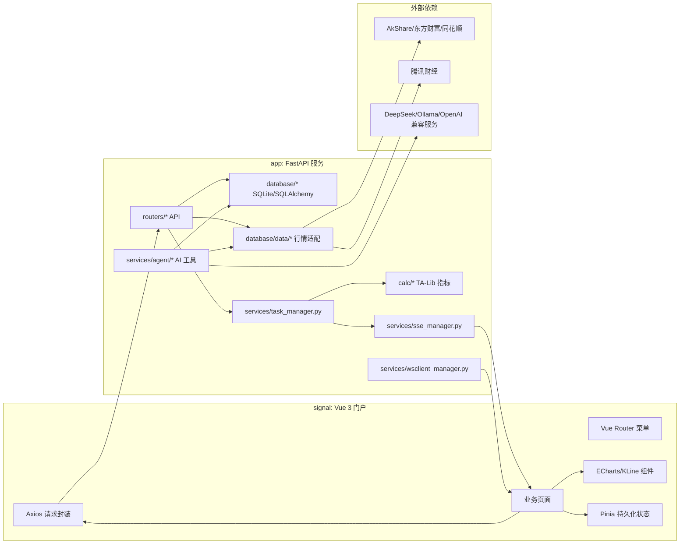
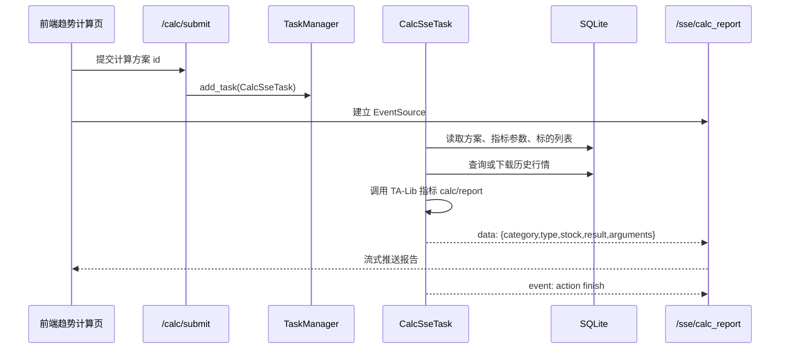

# Batman 工程功能梳理与复制指南

本文档用于指导复制 Batman 工程：既说明当前系统提供什么功能，也说明复刻时应该按哪些模块、数据结构和运行流程重建。

## 1. 项目定位

Batman 是一个面向 A 股、指数、基金/ETF/LOF 的个人投资数据分析工具。它由两部分组成：

- 后端 `app/`：Python FastAPI 服务，负责行情数据获取、SQLite 数据存储、持仓/自选/笔记管理、技术指标计算、SSE/WebSocket 实时通道、AI 咨询工具调用。
- 前端 `signal/`：Vue 3 + Vite 门户，负责登录、菜单路由、表格管理、K 线/指标图表、趋势计算任务展示、系统配置和 AI 聊天界面。

工程当前默认是单用户/弱认证模式：登录接口固定返回 token，后端只检查 `x-token` 请求头或 `token` 查询参数是否存在，并将用户统一映射为 `DEFAULT_UID = 99`。

## 2. 功能全景

### 2.1 用户侧功能

| 功能域 | 前端入口 | 后端模块 | 说明 |
| --- | --- | --- | --- |
| 登录与用户信息 | `/login` | `app/routers/account.py` | 固定账号体系占位，返回 `token-1`，用户信息固定为 BATMAN/admin/signal。 |
| 自选列表 | `/customized/list` | `app/routers/customized.py` | 添加/删除自选，编辑备注、目标价、排序，并可查看实时/历史行情。 |
| 持仓列表 | `/holding/list` | `app/routers/holding.py` | 添加持仓，买入/卖出/利息操作，资金可用余额联动变化，支持 K 线和收益图。 |
| 持仓详情 | `/holding/detail` | `app/routers/holding.py`、`/data/*` | 聚合持仓记录、交易流水、历史行情，展示收益、成本、仓位变化。 |
| 趋势计算 | `/analysis/trend` | `app/routers/calc.py` | 创建计算方案，选择计算范围、周期、指标参数，提交后台任务并通过 SSE 接收结果。 |
| 趋势参数设置 | `/analysis/trend-argument` | `app/database/calc.py` | 维护计算方案、标的列表、指标参数 JSON。 |
| 聚合图表 | `/analysis/trend-report-chart/:id` | 前端 store + calc 图表工具 | 对趋势计算结果做指标/行情聚合展示。 |
| AI 咨询 | `/analysis/agent` | `app/routers/agent.py`、`app/services/agent/*` | 选择 AI 模型，流式输出回答、思考、工具调用日志和行情图表。 |
| 三方技术数据 | `/data/third/*` | `app/routers/data_third.py` | 创新高、连续上涨、持续放量、量价齐升、涨停股池。 |
| 资讯链接 | `/data/links` | `app/routers/assets/info_links.json` | 返回分组资讯网站链接。 |
| 大盘云图 | `/data/market-cloud` | 前端页面 | 使用行情/图表能力展示大盘相关信息。 |
| 韭菜笔记 | `/notes/leek-notes` | `app/routers/notes.py` | 笔记增删改查，标签用 JSON 字符串存储。 |
| 系统配置 | `/sytem/configuration` | `app/routers/system.py` | 业务数据导入导出、标的列表初始化、历史缓存清理、交易日配置、行情源配置、AI 模型配置。 |

注意：系统配置路由当前拼写为 `/sytem/configuration`，不是 `/system/configuration`。复刻时若要兼容现有前端跳转，需要保留该路径或同步修改所有引用。

### 2.2 数据能力

系统支持的标的类型定义在前后端两侧保持一致：

| 类型 | 后端常量 | 前端常量 | 说明 |
| --- | --- | --- | --- |
| 指数 | `TYPE_INDEX = 1` | `TYPE_INDEX = 1` | A 股指数。 |
| 股票 | `TYPE_STOCK = 2` | `TYPE_STOCK = 2` | A 股股票。 |
| 基金 | `TYPE_FUND = 3` | `TYPE_FUND = 3` | 开放式基金、ETF、LOF 均归入基金类型。 |
| 开放式基金 | `FUND_TYPE_OPEN = 0` | `FUND_TYPE_OPEN = 0` | 通过基金净值接口转成类 K 线结构。 |
| ETF | `FUND_TYPE_ETF = 1` | `FUND_TYPE_ETF = 1` | 交易型基金，使用交易行情接口。 |
| LOF | `FUND_TYPE_LOF = 2` | `FUND_TYPE_LOF = 2` | 交易型基金，使用交易行情接口。 |

行情数据源有两类：

- `akshare`：默认数据源，用 AkShare 获取股票、指数、基金列表、历史行情、实时行情和三方榜单。
- `tencent`：可选行情源，工程内对股票/指数历史 K 线做了腾讯财经接口封装，部分场景用实时行情补当天数据。

系统配置中的“数据源配置”会写入 `app/db/data_config.json`。

## 3. 架构总览



后端启动入口是 `app/main.py`：

1. 创建 `FastAPI(title='Batman API', version='v0.3')`。
2. 启用 CORS，允许跨域请求。
3. 注册自定义 `AppException` 处理器，将业务异常包装成 `{ code, message }`。
4. 在 lifespan 中启动数据库建表、任务管理器和可选后台任务。
5. 注册所有路由。
6. 监听 SIGINT/SIGTERM，触发 SSE 关闭、任务管理器关闭和数据库关闭。

前端启动入口是 `signal/src/main.ts`，核心依赖是 Vue 3、Pinia、Vue Router、Element Plus、UnoCSS、ECharts、axios。

## 4. 后端模块拆解

### 4.1 路由层

后端路由统一注册在 `app/routers/__init__.py`。

| 路由模块 | 前缀 | 核心接口 |
| --- | --- | --- |
| `account.py` | `/account` | `/login`、`/logout`、`/info` |
| `data.py` | `/data` | 标的名称/信息查询、列表下载、历史行情下载/查询、实时行情查询、历史缓存清理 |
| `data_third.py` | `/data/third` | 技术榜单、资讯链接 |
| `funds.py` | `/funds` | 资金查询、资金更新、资金流水 |
| `holding.py` | `/holding` | 持仓创建、列表、状态变更、交易流水增删查 |
| `customized.py` | `/customized` | 自选创建、列表、删除、备注/目标价/排序更新 |
| `calc.py` | `/calc` | 计算方案、方案标的列表、指标参数、提交计算任务 |
| `sse.py` | `/sse` | `/calc_report`、`/agent` 两类 SSE 流 |
| `services.py` | `/services` | `/ws/spot_data` 自选行情 WebSocket |
| `system.py` | `/system` | 数据导入导出、交易日、行情源、AI 模型配置 |
| `notes.py` | `/notes` | 笔记列表、创建、更新、删除 |
| `agent.py` | `/agent` | AI 聊天提交、停止任务 |
| `libs.py` | `/libs/talib` | 示例性 MACD 计算接口 |

所有常规响应模型继承 `ResponseModel`：

```json
{
  "code": 0,
  "message": null,
  "result": {}
}
```

复刻时建议保留该响应约定，因为前端 axios 拦截器会按 `code === 0` 判断成功。

### 4.2 认证模型

当前认证是占位实现：

- 前端登录后将 token 存到 Pinia，默认请求头名是 `x-token`。
- `signal/src/axios/index.ts` 会给每个请求附加 `[tokenKey]: token`。
- 后端 `verify_token` 只检查请求头 `x-token` 或查询参数 `token` 是否存在。
- SSE 和 WebSocket 通过 URL 查询参数传 token。

如果复制时要做真实多用户，需要重点改造：

- 用户表和密码校验。
- token 签发、过期、刷新。
- `DEFAULT_UID = 99` 的全局替换。
- 表查询/写入中的 `uid` 隔离。

### 4.3 数据存储

数据库使用 SQLite，连接地址写死为：

```python
DATABASE_URL = 'sqlite:///./app/db/batman.db'
```

`DBEngine.start()` 在启动时通过 `TableBase.metadata.create_all()` 自动建表，没有迁移系统。复制工程时可以先按模型建表，后续如需长期演进应补迁移工具。

核心表：

| 表 | 模型文件 | 作用 |
| --- | --- | --- |
| `item_info_table` | `app/database/data/define.py` | 股票、指数、基金基础信息，主键为 `(type, code)`。 |
| `item_download_records` | `app/database/data/define.py` | 历史行情缓存区间记录。 |
| `history_stock_{period}_{adjust}_{code}` | 动态表 | 股票历史行情缓存。 |
| `history_index_{period}_{code}` | 动态表 | 指数历史行情缓存。 |
| `history_fund_{period}_{adjust}_{code}` | 动态表 | 基金历史行情缓存。 |
| `user_customized_record` | `app/database/customized.py` | 自选记录、目标价、排序、备注。 |
| `user_holding_table` | `app/database/holding.py` | 持仓主记录。 |
| `user_holding_operation_table` | `app/database/holding.py` | 买入、卖出、清仓、利息等交易流水。 |
| `funds_table` | `app/database/funds.py` | 资金总额和可用资金。 |
| `funds_operation_table` | `app/database/funds.py` | 资金变动流水。 |
| `calc_algorithm_items` | `app/database/calc.py` | 趋势计算方案主表。 |
| `calc_algorithm_item_stock_list` | `app/database/calc.py` | 计算方案自定义标的列表。 |
| `calc_algorithm_item_arguments` | `app/database/calc.py` | 计算方案指标参数，`arguments` 为 JSON 字符串。 |
| `note_items` | `app/database/notes.py` | 笔记内容，`tags` 为 JSON 字符串。 |

文件型配置：

| 文件 | 作用 |
| --- | --- |
| `app/db/data_config.json` | 行情源配置，`market_data_source` 可为 `akshare` 或 `tencent`。 |
| `app/db/ai_config.json` | AI 模型配置，包含 provider、base_url、api_key、model 等。 |
| `app/db/trade_calendar/{year}.json` | 每年交易日/非交易日配置。 |
| `app/services/agent/agent_config.yaml` | AI Agent 系统提示词、工具清单、记忆设置。 |
| `app/routers/assets/info_links.json` | 前端资讯链接分组。 |

### 4.4 行情数据层

数据门面是 `app/database/data/__init__.py`，按 `type` 分发到：

- `stock.py`：股票列表、历史行情、实时行情、部分财务/研报数据。
- `index.py`：指数列表、历史行情、实时行情。
- `fund.py`：基金列表、开放式基金净值、ETF/LOF 历史行情和实时行情。
- `third/stock.py`：同花顺/东方财富榜单数据。

历史行情查询流程：

1. 前端调用 `/data/get_history_data`。
2. 后端检查 `item_download_records` 是否已有覆盖 `start/end/period/adjust` 的缓存。
3. 如果未缓存，调用 AkShare 或腾讯接口下载。
4. 下载成功后写入动态 `history_*` 表，并更新下载记录。
5. 返回统一 `HistoryData` 结构：

```json
{
  "日期": "2026-07-20",
  "开盘": 0,
  "收盘": 0,
  "最高": 0,
  "最低": 0,
  "成交量": 0,
  "成交额": 0,
  "振幅": 0,
  "涨跌幅": 0,
  "涨跌额": 0,
  "换手率": 0
}
```

实时行情返回统一 `SpotData` 结构，包含最新价、涨跌幅、成交量、最高/最低/今开/昨收、量比、市盈率、市值等字段。

### 4.5 持仓与资金

持仓状态：

- `HOLDING_FLAG_ACTIVE = 1`：持有中。
- `HOLDING_FLAG_REMOVED = 2`：已移除。
- `HOLDING_FLAG_SOLDOUT = 3`：已清仓。

交易动作：

- `OPERATION_ACTION_BUY = 1`：买入，数量为正，`expense` 在存储时转为负数。
- `OPERATION_ACTION_SELL = 2`：卖出，数量存为负数，`expense` 为正数。
- `OPERATION_ACTION_SOLDOUT = 3`：清仓摘要记录。
- `OPERATION_ACTION_INTEREST = 4`：利息/分红类收入。

买入/卖出会联动 `funds_table.available`：

- 买入减少可用资金。
- 卖出增加可用资金。
- 利息增加可用资金。

清仓时，如果卖出数量等于当前持仓数量，后端会额外插入一条 `SOLDOUT` 摘要记录，并将持仓状态更新为 `SOLDOUT`。

### 4.6 技术指标与趋势计算

指标引擎在 `app/calc/`，统一模式是：

- 每个指标模块提供 `defaultOptions`、`calc(history_data, options)`、`report(history_data, calc_data, idx, options)`。
- `app/calc/__init__.py` 用 `CALC_MODULES` 注册分类和指标。
- 趋势计算任务按方案读取指标参数，遍历标的，输出每个指标的计算结果和报告结果。

当前指标分类：

| 分类 | 指标 |
| --- | --- |
| Overlap Studies 覆盖研究 | MA、SAR |
| Momentum Indicators 动量指标 | ADX、MACD、MACDEXT、RSI、MOM、KDJ |
| Volatility Indicators 波动率指标 | BOLL、ATR、NATR |
| Volume Indicators 成交量指标 | OBV、AD、VWAP |
| Price Transform 价格变换 | AVGPRICE、MEDPRICE |
| Pattern Recognition K 线形态识别 | CDLHAMMER、CDLENGULFING、CDLMORNINGSTAR、CDLDOJI、CDLEVENINGSTAR、CDL3WHITESOLDIERS、CDL3BLACKCROWS、CDLDARKCLOUDCOVER |
| Cycle Indicators 周期指标 | HT_DCPERIOD、HT_DCPHASE |

前端对应定义在 `signal/src/api/calc/defines.ts`，用于动态生成参数表单和展示分类名称。复制时要保持前后端指标 key 一致，例如 `MomentumIndicators/MACD`。

计算方案字段：

| 字段 | 含义 |
| --- | --- |
| `list_type` | 0 持仓、1 自选、2 自定义列表、3 全部、4 持仓&自选。 |
| `data_period` | 0 三个月、1 六个月、2 一年、3 两年。 |
| `report_period` | 0 全部或最近一天语义、1 最近三天、2 最近一周、3 最近一月。后端 `_get_report_index` 会转为信号点筛选数量。 |
| `show_opt` | 是否把完整计算序列返回前端，用于图表展示。 |

计算流：



### 4.7 异步任务、SSE 和 WebSocket

`TaskManager` 是一个独立线程中的 asyncio 循环，维护任务队列和任务 map。已有任务：

- `CalcSseTask`：趋势计算任务，输出类型 `calc_report`。
- `AgentSseTask`：AI 咨询任务，输出类型 `agent_chat`。
- `SpotDataFetchTask`：周期性抓取自选行情，默认未启用。
- `SpotDataClientManagerTask`：把行情快照发给 WebSocket 客户端。

SSE 管理器按 `{uid: {type: queue}}` 存连接队列。前端有两类 EventSource：

- `/sse/calc_report?token=...`
- `/sse/agent?token=...`

WebSocket 行情通道：

- 后端：`/services/ws/spot_data`
- 前端：`Customized/List.vue` 使用 `@vueuse/core` 的 `useWebSocket`
- 默认 `app/setting.py` 中 `TASK_SPOT_DATA_FETCH_ENABLED = False`，所以后台实时抓取任务默认不启动。复刻实时行情时需要打开该配置或改成前端按需轮询。

### 4.8 AI 咨询

AI 服务由这些文件组成：

| 文件 | 作用 |
| --- | --- |
| `app/routers/agent.py` | 接收聊天请求，选择 AI 模型配置，提交 `AgentSseTask`。 |
| `app/services/tasks/agent_sse_task.py` | 执行 Agent 并把 start/content/thinking/tool/chart/error/finish 流式发给前端。 |
| `app/services/agent/agent.py` | OpenAI 兼容流式客户端，处理 tool calls。 |
| `app/services/agent/config.py` | 读取 YAML/JSON Agent 配置。 |
| `app/services/agent/model_config.py` | 读取/保存 `app/db/ai_config.json`。 |
| `app/services/agent/fetch_data.py` | Agent 可调用的本地行情/持仓/图表工具。 |

默认模型配置：

- DeepSeek：`https://api.deepseek.com`，模型 `deepseek-chat`，API Key 从 `DEEPSEEK_API_KEY` 或系统配置读取。
- Ollama：`http://localhost:11434/v1`，模型 `qwen2.5:7b`，API Key 使用 `ollama` 占位。

Agent 工具能力：

- `get_datetime`：获取后端本地时间。
- `get_type`：把股票/指数/基金等类别转成数值类型。
- `resolve_item`：通过代码或名称解析标的。
- `get_history_data`、`get_latest_history_data`：读取行情历史。
- `get_spot_data`：读取指定标的实时行情。
- `record`、`get_holding_records`、`get_holding_operations`：读取持仓和交易记录。
- `calculate_indicators`：对传入行情记录做基础统计和均线计算。
- `build_chart_request`：构造前端可渲染的行情图请求。

## 5. 前端模块拆解

### 5.1 技术栈

- Vue 3.5
- Vite 6
- TypeScript 5
- Pinia + pinia-plugin-persistedstate
- Vue Router 4
- Element Plus
- ECharts + echarts-wordcloud
- UnoCSS + Less
- axios
- Vditor/WangEditor/MonacoEditor 等编辑组件

### 5.2 路由与权限

路由分两组：

- `constantRouterMap`：登录、根路径、个人中心、404。
- `asyncRouterMap`：业务菜单，自选、持仓、数据分析、三方数据、笔记、系统配置等。

`signal/src/permission.ts` 在路由前置守卫中：

1. 检查 Pinia 中是否有 `userInfo`。
2. 没登录则重定向 `/login`。
3. 登录后按静态/动态配置生成可访问路由。
4. 更新页面标题和进度条。

当前项目主要使用前端静态路由，后端没有真实权限菜单接口。

### 5.3 API 层

`signal/src/axios/index.ts` 是请求统一入口：

- 自动加 `Content-Type: application/json`。
- 自动加 `x-token` 请求头。
- 成功码固定为 `0`。
- Blob 响应用于导出文件。
- ISO 日期字符串会转成本地 `Date`，并加 8 小时时区补偿。

API 文件和后端路由基本一一对应：

| 前端 API | 后端路由 |
| --- | --- |
| `src/api/login` | `/account/*` |
| `src/api/data` | `/data/*` |
| `src/api/third` | `/data/third/*` |
| `src/api/customized` | `/customized/*` |
| `src/api/holding` | `/holding/*` |
| `src/api/funds` | `/funds/*` |
| `src/api/calc` | `/calc/*`、`/sse/calc_report` |
| `src/api/agent` | `/agent/*`、`/sse/agent` |
| `src/api/notes` | `/notes/*` |
| `src/api/system` | `/system/*`、`/data/remove_history_data` |

### 5.4 主要页面

| 页面 | 关键能力 |
| --- | --- |
| `Customized/List.vue` | 自选列表、标的搜索、目标价/备注、实时行情 WebSocket、K 线弹窗。 |
| `Holding/List.vue` | 持仓列表、创建持仓、交易操作、资金展示、K 线弹窗、活跃/清仓列表。 |
| `Holding/Detail.vue` | 单/多持仓详情、交易记录、持仓收益图。 |
| `Analysis/Trend.vue` | 选择计算方案、提交计算任务、展示计算结果。 |
| `Analysis/TrendArgument.vue` | 创建/编辑计算方案、标的列表和指标参数。 |
| `Analysis/components/CalcReport.vue` | 连接 SSE，收集趋势计算报告。 |
| `Analysis/components/CalcReportItem.vue` | 展示计算结果、内嵌图表、回测入口。 |
| `Analysis/TrendReportChart.vue` | 汇总多个计算结果成聚合图。 |
| `Analysis/Agent.vue` | AI 聊天、模型选择、思考开关、工具日志、图表自动展示。 |
| `System/Configuration.vue` | 导入导出、更新基础列表、清除历史缓存、交易日、行情源、AI 模型配置。 |
| `Notes/index.vue` | 笔记管理。 |
| `Third/Stock/*.vue` | 三方榜单表格和 K 线查看。 |

## 6. 关键业务流程

### 6.1 首次初始化

首次启动后，必须先初始化基础标的信息，否则自选、持仓、计算方案中的标的搜索和名称展示会缺数据。

推荐流程：

1. 登录前端。
2. 打开“系统配置”。
3. 点击“股票列表信息”。
4. 点击“指数列表信息”。
5. 点击“基金列表信息”。
6. 如需切换数据源，进入“数据源配置”选择 `akshare` 或 `tencent`。
7. 如需 AI 咨询，进入“AI配置”填写模型、Base URL 和 API Key。

这些操作会写入 SQLite 和 `app/db/*.json` 配置文件。容器部署时务必挂载 `/batman/app/db`，否则重启会丢数据。

### 6.2 自选与持仓

自选添加流程：

1. 前端按名称/代码调用 `/data/get_item_info`。
2. 用户确认后调用 `/customized/create`。
3. 后端检查 `item_info_table` 中是否存在该标的。
4. 插入 `user_customized_record`。
5. 列表页调用 `/customized/records` 展示名称、市场类型、目标价、备注、是否已持仓。

持仓交易流程：

1. 调用 `/holding/create` 创建持仓主记录。
2. 调用 `/holding/operation/create` 追加买入/卖出/利息。
3. 后端更新资金可用余额。
4. 列表通过 SQL 聚合交易流水得到当前数量和成本。
5. 清仓时写入摘要记录并更新持仓状态。

### 6.3 趋势计算

趋势计算方案由三部分组成：

1. `calc_algorithm_items`：方案名称、标的范围、数据周期、报告周期。
2. `calc_algorithm_item_stock_list`：当 `list_type = 2` 时使用的自定义标的。
3. `calc_algorithm_item_arguments`：指标分类、指标类型、参数 JSON。

执行时后端会根据 `list_type` 解析标的来源：

- 0：持仓。
- 1：自选。
- 2：自定义列表。
- 3：全部标的基础表。
- 4：持仓 + 自选。

### 6.4 数据导入导出

系统配置中的导出只覆盖部分业务表：

- `user_holding_table`
- `user_holding_operation_table`
- `funds_table`
- `funds_operation_table`
- `user_customized_record`

导出流程会把这些表分别导成 JSON，再打包成 `export_YYYY-MM-DD.zip`。导入会解压并覆盖导入这些表。

未包含在导入导出中的内容：

- 标的基础表 `item_info_table`
- 历史行情动态表
- 趋势计算方案表
- 笔记表
- AI/数据源/交易日配置文件

复制工程时如果要完整迁移个人数据，应额外备份整个 `app/db/` 目录。

## 7. 运行与部署

### 7.1 本地开发

后端建议在仓库根目录运行，确保 `sqlite:///./app/db/batman.db` 和相对路径配置正确。

```bash
cd /path/to/Batman
python -m venv .venv
source .venv/bin/activate
pip install -r app/requirements.txt
uvicorn app.main:app --host 0.0.0.0 --port 8000 --reload
```

后端依赖 TA-Lib。`requirements.txt` 使用 `ta-lib==0.6.4`，不同系统可能还需要先安装 TA-Lib C 库。Docker 构建文件中展示了 Linux 下从源码安装 TA-Lib 的方式。

前端：

```bash
cd /path/to/Batman/signal
pnpm install
pnpm run dev
```

默认前端开发端口是 `3030`，默认 API 地址在 `.env.base` / `.env.dev` / `.env.pro` 中配置为 `http://localhost:8000`。

### 7.2 生产构建

前端生产构建：

```bash
cd /path/to/Batman/signal
pnpm run build:pro
```

后端生产启动：

```bash
cd /path/to/Batman
uvicorn app.main:app --host 0.0.0.0 --port 8000
```

### 7.3 Docker 部署

推荐使用 `deploy/` 下的双镜像方案：

- `deploy/dockerfile.app`：构建后端镜像，安装 Python 依赖和 TA-Lib。
- `deploy/dockerfile.signal`：构建前端镜像，Nginx 监听 `3030`。
- `deploy/docker-compose.yml`：编排 app + signal。
- `deploy/docker-compose-services.yml`：使用已发布镜像的简化服务编排。

从源码构建：

```bash
docker build -f deploy/dockerfile.app -t codejie/batman:app .
docker build -f deploy/dockerfile.signal -t codejie/batman:signal --build-arg API_URL=http://localhost:8000 .
docker compose -f deploy/docker-compose.yml up -d
```

使用预构建镜像：

```bash
curl -o docker-compose-services.yml https://raw.githubusercontent.com/codejie/Batman/master/deploy/docker-compose-services.yml
docker compose -f docker-compose-services.yml up -d
```

默认访问地址：

- 前端：http://localhost:3030
- 后端 OpenAPI：http://localhost:8000/docs

根目录还有一个单镜像 `dockerfile`，它会在同一容器中同时运行 FastAPI 和静态前端服务，并通过根目录 `docker-compose.yml` 暴露 `8000` 和 `3030`。复制工程时如果想降低运维复杂度可以用单镜像；如果想更接近生产职责分离，优先用 `deploy/` 双镜像。

### 7.4 容器数据持久化

后端容器需要持久化：

```yaml
volumes:
  - ./app/db:/batman/app/db
```

或在 `deploy/docker-compose.yml` 中使用：

```yaml
volumes:
  - ${BATMAN_VOLUME:-.}:/batman/app/db
```

复制部署时要确认挂载目录包含：

- `batman.db`
- `data_config.json`
- `ai_config.json`
- `trade_calendar/`
- 其他导入导出或临时数据

## 8. 复制工程的实施清单

如果从零复刻同类系统，建议按下面顺序实现。

### 8.1 后端优先级

1. 搭建 FastAPI 基础服务：统一响应、异常处理、CORS、路由注册、lifespan。
2. 搭建 SQLite + SQLAlchemy：`TableBase`、`DBEngine`、自动建表、JSON 导入导出。
3. 实现标的基础表和行情数据门面：指数/股票/基金三类基础信息下载。
4. 实现历史行情缓存：动态表命名、下载记录、缓存命中检查、强制清理。
5. 实现自选列表：CRUD、标的存在性校验、目标价/备注/排序。
6. 实现资金与持仓：资金主表、持仓主表、交易流水、清仓逻辑、聚合查询。
7. 实现系统配置：数据导入导出、数据源配置、交易日配置、AI 模型配置。
8. 实现 TA-Lib 指标框架：统一 `calc/report` 协议、指标注册表。
9. 实现计算方案和后台任务：方案表、指标参数表、TaskManager、SSE 推送。
10. 实现 AI Agent：模型配置、OpenAI 兼容客户端、工具 schema、本地数据工具、SSE 流。
11. 可选实现 WebSocket 行情推送：后台行情抓取任务和客户端管理。

### 8.2 前端优先级

1. 搭建 Vue 3 + Vite + Element Plus + Pinia + Router。
2. 实现 axios 封装：baseURL、token header、统一成功码、Blob 下载、错误处理。
3. 实现登录和静态路由守卫。
4. 实现系统配置页，用于初始化基础数据。
5. 实现通用标的搜索弹窗，复用 `/data/get_item_info`。
6. 实现自选列表和 K 线弹窗。
7. 实现持仓列表、交易弹窗、持仓详情和收益图。
8. 实现趋势方案列表、参数编辑器、计算提交和 SSE 结果展示。
9. 实现三方数据榜单页面。
10. 实现笔记页面。
11. 实现 AI 咨询页面：模型选择、SSE 流、工具日志、图表卡片。

### 8.3 前后端契约

复制时必须保持这些契约一致：

- 成功响应 `code = 0`。
- token 请求头默认名 `x-token`。
- SSE 查询参数名 `token`。
- 标的类型数值：指数 1、股票 2、基金 3。
- 历史行情字段使用中文列名。
- 指标分类 key 和指标 key 与 `CALC_MODULES` 一致。
- 计算参数 `arguments` 是 JSON 字符串。
- AI 图表请求结构包含 `kind`、`item`、`range`、`overlays`。

## 9. 外部依赖与风险点

| 风险点 | 说明 | 复制建议 |
| --- | --- | --- |
| AkShare 接口变化 | 行情/榜单接口依赖外部网站结构，字段可能变化。 | 在数据适配层做字段归一和异常兜底，保留可切换数据源。 |
| TA-Lib 安装 | Python 包通常依赖 TA-Lib C 库。 | Docker 中从源码编译；本地开发需预装系统库。 |
| 弱认证 | 当前不是完整多用户体系。 | 若公开部署，必须补真实认证和授权。 |
| SQLite 动态表 | 每个标的会创建独立历史表，长期运行表数量会增长。 | 小规模个人使用可接受；大规模复制建议改成统一 history 表并建复合索引。 |
| 测试依赖网络 | 多数数据测试会访问外部行情源。 | 把网络测试和纯单元测试拆开，增加 fixture/mock。 |
| 前端 WebSocket URL | 自选页当前拼接方式依赖 `PATH_URL`，跨协议/反代时要仔细处理。 | 生产环境建议单独配置 `VITE_WS_BASE_PATH`。 |
| 系统配置路径拼写 | 当前路由为 `/sytem/configuration`。 | 复制时保留兼容或统一改名并全局替换。 |
| 数据导出范围有限 | 系统导出不包含所有表和配置文件。 | 完整迁移时备份整个 `app/db`。 |

## 10. 最小可运行版本范围

如果只复制核心能力，建议先实现以下闭环：

1. 登录占位 + 静态路由。
2. 系统配置页下载股票/指数/基金基础信息。
3. 自选列表添加标的并展示实时/历史行情。
4. 持仓列表记录买入卖出并聚合持仓。
5. 一组指标，例如 MA/MACD/RSI/BOLL。
6. 一个趋势计算方案，通过 SSE 返回结果。
7. Docker 双镜像部署和 `app/db` 持久化。

在这个闭环稳定后，再扩展 AI 咨询、WebSocket 实时推送、三方榜单、笔记和更多指标。

## 11. 目录速查

```text
Batman/
  README.md                         项目简要启动说明和截图
  dockerfile                        单容器镜像构建
  docker-compose.yml                单容器运行示例
  deploy/
    dockerfile.app                  后端镜像
    dockerfile.signal               前端镜像
    docker-compose.yml              双服务编排
    docker-compose-services.yml     预构建镜像编排
    nginx.signal.conf               前端 Nginx 配置
  app/
    main.py                         FastAPI 入口
    setting.py                      后台行情任务开关
    database/                       SQLite/SQLAlchemy 数据层
    routers/                        API 路由层
    services/                       任务、SSE、WebSocket、AI Agent
    calc/                           TA-Lib 指标计算模块
    libs/talib/                     TA-Lib 封装示例
    test/                           开发期测试/验证脚本
  signal/
    package.json                    前端依赖和脚本
    vite.config.ts                  Vite 配置
    .env.*                          前端环境变量
    src/api/                        API 契约
    src/router/                     菜单路由
    src/views/                      页面
    src/components/                 通用组件和图表组件
    src/store/                      Pinia 状态
    src/calc/                       前端图表计算辅助
  screenshots/                      README 截图
  docs/
    project-replication-guide.md    本文档
```

## 12. 验证建议

复制后建议按以下顺序验收：

1. 后端 `/docs` 可访问。
2. 前端 `/login` 可登录并进入 `/holding/list`。
3. 系统配置能成功更新股票、指数、基金基础列表。
4. 自选列表能添加股票、指数、ETF/LOF/基金。
5. 历史行情接口 `/data/get_history_data` 能返回统一中文字段。
6. 持仓买入/卖出后，数量、成本、可用资金变化符合预期。
7. 趋势计算方案能提交，`/sse/calc_report` 能收到 `start/data/finish`。
8. AI 配置启用后，`/agent/chat` 能提交任务，`/sse/agent` 能收到流式内容。
9. 容器重启后 `app/db` 中的数据仍存在。

