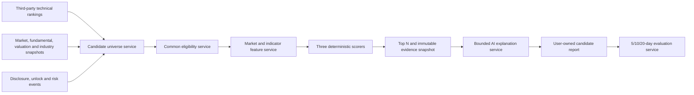

# AI Candidate Research Workspace Design

Date: 2026-08-11

Status: Approved for implementation planning

## 1. Purpose

IronMan currently exposes five third-party technical rankings, historical market data, 26 deterministic trend indicators, curated information links, official disclosure collection, AI consultation, asynchronous analysis tasks, and alert rules. These capabilities do not yet form a repeatable market-wide research loop: the technical rankings find active stocks, but the product does not apply shared eligibility rules, compare alternative investment styles, preserve evidence snapshots, or measure what happened after a candidate was published.

Add an `AI 候选` workspace under the `数据分析` menu. It produces daily Top N research candidates for a 5-20 trading-day observation horizon through three independent strategies:

- `趋势事件`: short-cycle trend, volume, ranking consensus, and structured event catalysts;
- `质量成长`: financial quality and growth as the eligibility thesis, with short-cycle technical timing;
- `低估值修复`: industry-relative valuation and fundamental improvement, with short-cycle reversal confirmation.

The feature is a research and decision-support surface. It does not promise returns, execute trades, or let an LLM invent scores or bypass risk filters.

## 2. Goals And Non-Goals

### Goals

- Build strategy-specific candidate pools from third-party technical rankings and market-wide normalized snapshots.
- Apply identical tradability, freshness, and severe-risk filters before scoring.
- Produce deterministic, versioned, explainable scores before invoking AI.
- Let AI turn structured evidence into bounded conditional actions with citations and uncertainty.
- Preserve every run, item, data source, algorithm version, and model version as an immutable historical recommendation snapshot.
- Evaluate recommendation cycles at 5, 10, and 20 trading days without look-ahead or survivorship bias.
- Keep tasks, settings, AI output, and history isolated by user while sharing only non-private market caches.
- Continue to provide useful quantitative results when AI or a non-critical source is unavailable.

### Non-Goals

- Broker integration, automatic orders, position sizing, or portfolio rebalancing.
- Personalized buy or sell instructions based on the user's holdings, available cash, or risk profile.
- Intraday prediction or tick-level execution simulation.
- Unrestricted web browsing by the model.
- Treating external page links or iframe content as facts that the system has read.
- Claiming long-term business value from a 5-20 day outcome window.

## 3. Product Structure

Add the menu item after `持仓诊断` and before `AI咨询`:

```text
数据分析
├── 趋势计算
├── 持仓诊断
├── AI候选
└── AI咨询
```

Use route `/analysis/ai-candidates`.

The workspace has two levels of tabs:

1. View tabs: `今日候选`, `历史推荐`, `效果评估`.
2. Strategy tabs within every view: `趋势事件`, `质量成长`, `低估值修复`.

The compact toolbar contains trade date, Top 5/10/20 selection, latest data timestamps, run status, and a manual-run command. Top N is a maximum rather than a quota; a risk-constrained day may return fewer results or no qualified result.

The candidate table shows rank, instrument, industry, total score, compact component scores, action, reference range, invalidation condition, validity, and data quality. Selecting a row opens a detail surface containing score contributions, positive and contrary evidence, local K-line and indicator charts, AI interpretation, evidence sources, and the recommendation cycle history.

Users may explicitly add an instrument to their watchlist or create an alert from a candidate. AI cannot perform either write automatically.

## 4. Architecture



### Backend Boundaries

`CandidateDataAdapter`
: Obtains normalized technical ranking, market universe, fundamental, valuation, industry, structured event, and risk data. The AI layer never calls upstream URLs directly.

`CandidateSnapshotService`
: Validates contracts, normalizes fields and units, caches shared market facts, records source/freshness status, and supplies an as-of snapshot. A user-owned run copies every fact it relies on into immutable evidence JSON.

`CandidateUniverseService`
: Builds the three initial universes. Trend-event starts with the union of the five existing technical rankings and later low-weight ranking sources. Quality-growth and value-repair start from market-wide fundamental and valuation snapshots.

`CandidateEligibilityService`
: Applies common hard filters. It returns structured rejection reasons and never silently drops a candidate.

`CandidateFeatureService`
: Reuses `MarketService` and `TrendIndicatorService` to calculate historical returns, relative strength, volume/price behavior, volatility, drawdown, local signals, and turning points.

`CandidateScoringService`
: Applies versioned deterministic formulas. It returns raw factor values, normalized factor percentiles, group scores, total score, and the market-regime threshold used.

`CandidateExplanationService`
: Gives the configured AI model only the selected candidate's structured snapshot and whitelisted evidence excerpts. It validates the structured response, attempts one repair, and otherwise creates a deterministic local explanation.

`CandidateRunService`
: Owns user-isolated asynchronous runs, progress, cancellation, partial completion, logs, persistence, deduplication, and event streaming.

`CandidateEvaluationService`
: Advances recommendation cycles and 5/10/20-day evaluations idempotently after daily market data is available.

### Provider Expansion

Extend the local AKShare provider with semantic POST endpoints rather than exposing arbitrary AKShare calls:

- `/v1/candidates/market-snapshot`: A-share identity, exchange, board, industry, listing date, trade status, latest quote, amount, market capitalization, float capitalization, PE, PB, PS, and data as-of time.
- `/v1/candidates/fundamental-snapshot`: report period, publication time, financial profile, revenue/profit growth, ROE/ROA, margins, operating cash flow, net profit, leverage/safety fields, and source metadata.
- `/v1/candidates/event-snapshot`: structured earnings forecast, dividend, buyback, shareholder change, unlock, regulatory/risk warning, and disclosure metadata for a bounded code list and date window.
- Continue using `/v1/technical/ranking` for the five existing technical pools.
- Continue using `/v1/disclosures/cninfo` and `/v1/news/stock` only for the small final set that needs source-backed AI explanation.

Candidate contracts use stable English field names and include `source`, `publishedAt` or `tradeDate`, and `retrievedAt`. Adapters are responsible for translating upstream Chinese columns. Free-form upstream column names must not leak into scoring code.

Historical liquidity calculations require normalized monetary amount. Add nullable `amount` and `turnoverRate` fields to normalized daily bars and persisted market bars. A source may use `close * volume` only when its volume unit is explicitly normalized to shares; otherwise liquidity is incomplete and the candidate fails the liquidity requirement.

## 5. Run Data Flow

1. Resolve the most recent completed trading day through `TradingCalendarService`.
2. Read or refresh the shared market, fundamental, valuation, industry, and structured-event snapshots.
3. Fetch all five technical rankings through the existing fallback chain.
4. Build three strategy-specific low-cost universes. Cap each at 200 candidates before expensive history work.
5. Apply identity, severe-risk, freshness, listing-age, and basic-liquidity filters.
6. Fetch or reuse up to 180 daily bars only for remaining candidates and calculate deterministic features.
7. Apply final liquidity and data-coverage requirements, industry normalization, strategy scores, and market-regime thresholds.
8. Persist the complete scored finalists, including rejected-at-final-stage reasons. Mark at most the configured Top N as selected.
9. Fetch bounded official disclosure/news evidence and ask AI to explain only selected items.
10. Complete the run as `completed` or `partial`; expose the quantitative result even when AI fails.
11. After subsequent daily data arrives, advance recommendation cycles and mature 5/10/20-day evaluations.

The two-stage process avoids downloading full history and source documents for the complete A-share universe. Repeated manual clicks reuse a queued or running task for the same user and trade date. A completed run may be rerun as a new immutable version; it never overwrites the earlier run.

## 6. Eligibility Rules

The first release uses these explicit common rules:

- Only Shanghai, Shenzhen, and Beijing A-share ordinary stocks are eligible.
- The stock must have been listed for at least 120 calendar days.
- At least 120 valid daily bars must be available.
- The latest bar may lag the resolved trading date by no more than one trading day.
- Exclude `ST`, `*ST`, delisting-consolidation, suspended, and explicit severe delisting-risk instruments.
- At least 15 of the latest 20 trading days must contain valid trades.
- Average daily amount over the latest 20 valid days must be at least CNY 50 million.
- Quality-growth and value-repair require a financial publication within the previous 210 calendar days and at least 80% coverage of their required factor groups.
- Instrument identity, latest market data, and strategy-critical financial fields must be cross-validated; an unverified critical source prevents Top N selection.

Consecutive limit-ups, extreme distance from trend, very high normalized volatility, large upcoming unlocks, major reductions, and non-severe regulatory events are penalties or conditional-action inputs rather than unconditional exclusions. A one-price limit-up or suspension on the proposed entry day is not considered executable.

## 7. Normalization And Market Regime

Numeric cross-sectional factors are winsorized at the 2.5th and 97.5th percentiles. Each factor becomes a 0-100 percentile within its industry. An industry with fewer than 10 eligible peers falls back to the entire market within the same financial profile. Lower-is-better factors use the inverse percentile. Factors inside a score group have equal weight unless a future algorithm version explicitly records a different formula.

Use separate `general` and `financial` profiles so that ordinary-company cash flow and leverage formulas are not applied mechanically to banks, insurers, and brokers. A profile without enough applicable factors fails coverage rather than silently redistributing missing weight.

Market regime is deterministic and versioned. It uses major-index trends, A-share advance ratio, new-high/new-low breadth, and cross-sectional volatility:

- `strong`: minimum selected score 65;
- `neutral`: minimum selected score 70;
- `risk`: minimum selected score 75 and mandatory trend plus liquidity confirmation;
- unavailable regime inputs: treat as `risk` and disclose the missing evidence.

The system does not fill Top N below the applicable threshold.

## 8. Strategy Scoring

Every strategy returns a 0-100 score. The weights below are algorithm version `ai-candidate-v1`.

### Trend Event

| Group | Weight | Inputs |
| --- | ---: | --- |
| Trend and relative strength | 30 | 5/10/20/60-day returns versus market and industry, MA structure, MACD, ADX |
| Volume and liquidity | 20 | amount expansion, volume-price confirmation, OBV/AD direction, liquidity stability |
| Ranking consensus | 15 | number and persistence of technical pools, with duplicate rows removed |
| Structured catalyst | 15 | official structured earnings, buyback, dividend, contract, and risk-event fields; unclassified prose is neutral |
| Market fit | 10 | regime and industry strength |
| Volatility and overheat control | 10 | NATR, gap risk, drawdown, distance from trend, consecutive limit behavior |

### Quality Growth

| Group | Weight | Inputs |
| --- | ---: | --- |
| Profitability quality | 20 | ROE/ROA, margin level and stability within the applicable profile |
| Growth and persistence | 20 | revenue and profit growth plus multi-period stability |
| Cash conversion | 15 | operating cash flow versus profit for general companies; profile-specific stability factors for financial companies |
| Financial safety | 15 | profile-specific leverage, liquidity, and earnings stability |
| Trend confirmation | 15 | relative strength, MA/MACD/ADX confirmation, avoidance of deteriorating trend |
| Liquidity and volatility control | 15 | amount, NATR, gap and drawdown risk |

### Low Valuation Repair

| Group | Weight | Inputs |
| --- | ---: | --- |
| Industry-relative valuation | 30 | positive-earnings PE, PB, PS and profile-appropriate valuation percentiles |
| Fundamental improvement | 25 | growth acceleration, margin/ROE improvement, cash-flow or profile-specific improvement |
| Technical reversal | 20 | trend reclaim, MACD/RSI/KDJ change, relative-strength recovery and turning points |
| Structured events and risk | 10 | official improvement catalysts minus unlock, reduction and regulatory-risk penalties |
| Liquidity and volatility control | 15 | amount, NATR, gap and drawdown risk |

AI has no access to score mutation. Algorithm versions and raw inputs are stored with every run.

## 9. AI Explanation Contract

```typescript
interface CandidateExplanation {
  summary: string
  action: "observe" | "wait_pullback" | "wait_breakout" | "research_further" | "avoid"
  thesis: string[]
  counterEvidence: string[]
  referencePriceLow: number | null
  referencePriceHigh: number | null
  invalidationPrice: number | null
  validUntil: string
  uncertainty: string
  evidenceIds: string[]
}
```

Validation rules:

- The instrument must be the selected item supplied to the model.
- Every `evidenceId` must exist in the immutable run snapshot.
- Price fields must be finite, non-negative, and ordered; a missing defensible range is represented by null rather than invented.
- `validUntil` must be a trading day no later than 20 trading days after publication. Default validity is 10 trading days.
- External text is untrusted evidence, never an instruction. Model tools remain whitelisted and cannot write assets, alerts, settings, or transactions.
- Invalid output receives one constrained repair attempt. A second failure produces a local explanation and an explicit AI status.

## 10. Persistence

Add the following user-owned tables. All ownership queries include `user_id`, and foreign keys cascade on user or run deletion.

`ai_candidate_runs`
: User, trigger (`manual` or `scheduled`), trading date, status (`queued`, `running`, `completed`, `partial`, `failed`, `cancelled`), progress, requested Top N, algorithm version, market-regime snapshot, data-quality summary, model snapshot, error, and timestamps.

`ai_candidate_items`
: Run, user, instrument, strategy, rank, score, percentile, selected flag, score snapshot JSON, evidence snapshot JSON, explanation JSON, AI status, data quality, rejection/error detail, recommendation-cycle reference, and timestamp. Persist every scored finalist up to the 200-item strategy cap; only selected items receive AI explanations.

`ai_candidate_cycles`
: User, strategy, instrument, first and latest item references, state (`waiting_entry`, `tracking`, `matured`, `invalidated`, `not_executable`, `indeterminate`), signal date, simulated entry date/price, validity, and timestamps.

`ai_candidate_evaluations`
: User, item, optional recommendation cycle, horizon (`5`, `10`, `20`), state, target/actual valuation date, entry and exit price, benchmark values, gross and cost-adjusted return, market/industry excess return, MFE, MAE, maximum drawdown, invalidation result, data quality, and timestamp. Enforce one row per item and horizon. Every scored finalist receives a lightweight forward evaluation; only selected items participate in user-facing recommendation-cycle results.

`ai_candidate_run_logs`
: User, run, level, stage, message, structured context, and timestamp.

Non-private provider caches may be shared, but a cache cleanup cannot remove evidence already copied into a user-owned historical item.

## 11. Recommendation Cycles And Evaluation

Use the next executable trading-day open after an after-close signal as the base simulated entry. Never use the signal-day close. A one-price limit-up, suspension, or missing reliable open is `not_executable`. For `wait_pullback` or `wait_breakout`, the first valid trigger within the recommendation validity starts tracking; daily OHLC ambiguity that triggers entry and invalidation in the same bar is `indeterminate`.

Track each executable cycle at 5, 10, and 20 trading days. Calculate:

- gross and estimated cost-adjusted return;
- market and industry excess return;
- maximum favorable excursion (MFE);
- maximum adverse excursion (MAE);
- maximum drawdown;
- invalidation occurrence;
- score-to-future-return rank correlation and Top N precision by run;
- results by strategy, algorithm version, and market regime.

Settle the same horizon fields for every scored finalist, not only Top N, so a run can measure score-to-return correlation, selection precision, and Top N lift against its actual contemporaneous pool. These item-level outcomes are research diagnostics grouped by run; they are not presented as independent recommendations and do not enter the user-facing success count.

The first release's versioned cost estimate is 20 basis points round trip. Show gross and estimated net results separately and state that this is not a brokerage statement.

Repeated selections for the same user, strategy, and instrument during an active cycle preserve new immutable daily item snapshots but link to the existing cycle as signal confirmations. They do not count as independent successes. A new cycle starts only after the prior cycle is invalidated, becomes non-executable, or completes 20 trading days.

Cycle-level statistics use the first executable signal as the canonical observation. Later linked item outcomes remain available for threshold and rank diagnostics, but cycle aggregation deduplicates them by `cycle_id`.

Free-form prose has no accuracy metric. Quantitative selection quality and structured AI action quality are reported separately. AI metrics include trigger rate, post-trigger directional result, invalidation coverage, and whether a wait condition reduced MAE.

## 12. Scheduling And APIs

Candidate settings are user-owned. Defaults are: scheduled scan enabled, all three strategies enabled, Top 10, default explanation validity 10 trading days, maximum validity 20 trading days, and post-close execution at 18:30 Asia/Shanghai. Users may disable scheduled scans or change Top N to 5 or 20.

The automation loop runs one scheduled scan per enabled user and trading date, and runs evaluation settlement idempotently after market data is available. Reuse the repository's task/log patterns and trading calendar. Remote AI usage is bounded to selected candidates and recorded per run.

All regular APIs use POST bodies:

- `/api/analysis/ai-candidates/settings/get`
- `/api/analysis/ai-candidates/settings/update`
- `/api/analysis/ai-candidates/runs/create`
- `/api/analysis/ai-candidates/runs/list`
- `/api/analysis/ai-candidates/runs/detail`
- `/api/analysis/ai-candidates/runs/cancel`
- `/api/analysis/ai-candidates/latest`
- `/api/analysis/ai-candidates/evaluations/summary`

An authenticated SSE endpoint may use GET for progress events, consistent with the repository's existing stream exception.

## 13. Failure And Security Behavior

- AI unavailable: retain and publish deterministic rankings with `local` or `unavailable` AI status.
- Fundamental source unavailable: trend-event may complete; quality-growth and value-repair become partial or empty with explicit reasons.
- One instrument fails: isolate it and continue the run.
- Critical market identity or latest-history failure: fail the affected strategy or entire run rather than present stale data as current.
- Retry an upstream stage at most twice with bounded timeout and log both attempts.
- Repeated manual starts return the active run instead of launching concurrent market-wide scans.
- Evaluation settlement is idempotent and uniqueness-constrained.
- Provider credentials and AI keys remain server-side and never enter evidence snapshots or model prompts.
- Evidence excerpts are length bounded, source whitelisted, and labelled as official, aggregated, or metadata-only.
- No browser-native `alert`, `confirm`, or `prompt` is introduced.

## 14. Testing And Acceptance

Follow TDD and cover these groups before implementation behavior:

### Provider Contract Tests

- Normalize successful market, financial, valuation, industry, and event payloads.
- Reject malformed types, missing as-of fields, non-finite numbers, unexpected sources, oversized payloads, and timeouts.
- Confirm bounded code lists and source allowlists.

### Backend Unit And Route Tests

- Three universe builders, deduplication, 200-item cap, hard-filter reasons, winsorization, industry/profile normalization, group formulas, weights, and regime thresholds.
- Success path, user isolation, invalid inputs, stale data, missing fields, and every external-source failure mode.
- AI valid output, unsupported tool request, unknown evidence ID, invalid prices, invalid validity, repair success, repair failure, timeout, and local fallback.
- Scheduled/manual run deduplication, cancellation, partial completion, retry limits, logs, and immutable reruns.
- Next-day-open entry, non-executable limit-up/suspension, OHLC ambiguity, 5/10/20 maturity, estimated costs, benchmark return, MFE, MAE, drawdown, invalidation, and idempotent settlement.
- Full scored-pool item evaluation, Top N lift, and cycle-level deduplication of repeated selections.
- Repeated daily recommendations link to one active cycle and do not inflate outcome counts.

### Frontend Tests

- `数据分析 > AI候选` menu and route.
- View tabs, strategy tabs, Top N control, date selection, run command, progress, empty state, partial state, failure state, and AI fallback state.
- Dense table rendering, score explanations, source status, detail surface, historical recommendation lookup, and evaluation comparison.
- Explicit watchlist and alert actions use existing feedback/confirmation patterns.
- Text fits and controls remain stable at desktop and mobile widths.

### Acceptance Criteria

- A completed run can explain every selected score using persisted raw factors and evidence.
- No AI response can add an instrument, alter a score, cite absent evidence, or execute a write action.
- One user cannot read, cancel, evaluate, or reuse another user's run or history.
- Historical results never use information published after the recommendation as input and never assume signal-day-close execution.
- Delisted, suspended, failed, and non-executable candidates remain visible in history rather than disappearing from statistics.
- The UI accurately distinguishes quantitative output, AI output, source degradation, and estimated historical evaluation.
- `bun test`, frontend tests, provider tests, lint, and builds pass before delivery.

## 15. Delivery Sequence

Implement as one feature through four testable vertical stages:

1. Provider snapshot contracts, normalized amount fields, cache behavior, and database migrations.
2. Deterministic universes, filters, features, scorers, tasks, persistence, and route contracts.
3. AI explanation, source evidence, local fallback, recommendation cycles, and evaluation settlement.
4. Menu, workspace views, candidate details, history/evaluation UI, alerts/watchlist actions, and full verification.

Each stage must leave existing third-party data, market history, trend analysis, holding diagnosis, AI consultation, and alert behavior passing.

## 16. Research Basis

- Jegadeesh and Titman, *Returns to Buying Winners and Selling Losers* (1993): medium-horizon momentum evidence.
- Daniel and Moskowitz, *Momentum Crashes* (2016): momentum crash risk in panic/high-volatility rebounds.
- Pastor and Stambaugh, *Liquidity Risk and Expected Stock Returns* (2003): liquidity as a material priced risk.
- Ang et al., *High Idiosyncratic Volatility and Low Returns* (2009): evidence against treating extreme volatility as automatically attractive.
- Asness, Frazzini, and Pedersen, *Quality Minus Junk* (2019): profitability, growth, and safety as quality dimensions.
- Bailey and Lopez de Prado, *The Deflated Sharpe Ratio* (2014): multiple-testing and backtest-selection bias.
- Shanghai Stock Exchange listing and risk-warning rules: severe-risk eligibility exclusions.
- CNINFO official disclosures and AKShare stock-data documentation: source and adapter feasibility.

These references inform factor selection and validation discipline. They do not establish that this implementation will earn a positive return; only immutable forward evaluation can measure its behavior in IronMan's data and target market.
